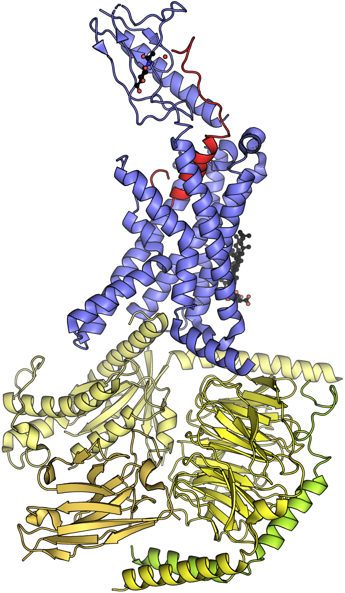

# Awesome Peptide Company

🔬 **An evidence-based directory of organizations working with peptides and AI.**

Explore biotech companies, pharmaceutical AI teams, technology-company research teams, and pharmaceutical companies with peptide activity. AI–peptide work and the broader peptide landscape are shown separately; a landscape entry does not imply a documented AI connection. Each profile connects claims to sources and distinguishes confirmed information from reports and open questions. This directory is not a ranking or a marketplace.

  
   
  Calcitonin–receptor complex, <a href="https://www.rcsb.org/structure/7TYO">PDB 7TYO</a>. Image by <a href="https://commons.wikimedia.org/wiki/File:Human_calcitonin_recptor-Gs_complex_PDB_7TYO.png">Synpath</a>, CC0.

## Explore

- **Organizations:** [By name](index/by-name.md) · [By scope](index/by-scope.md) · [By type](index/by-type.md) · [By status](index/by-status.md) · [By region](index/by-region.md)
- **Research:** [By peptide modality](index/by-modality.md) · [By dry–wet loop](index/by-loop-level.md) · [Assets](index/assets.md)
- **Overviews:** [Pharmaceutical companies](docs/pharma-survey.md) · [China company survey](docs/china-company-survey.md)
- **Relationships:** [Lineage](index/lineage.md) · [Recent changes](index/changes.md)
- **Data:** [CSV](index/index.csv) · [JSON](index/index.json) · [Source tables](data/)

Each entry links to a profile with its evidence, assets, and timeline. Status and loop assessments are evidence-based and may remain unconfirmed or unassessed.

## Organizations

<!-- BEGIN:INDEX -->

### AI–peptide work

- **[AilsynBio (昂心生物)](cards/ailsynbio/README.md)** 
  Hong Kong AI-native biotechnology company focused on peptide therapeutics. 
  AI-native biotech · Active · Core relevance · HK

- **[AIMEDORIG (智药元创)](cards/aimedorig/README.md)** 
  AIMEDORIG describes an AI-driven peptide and protein drug discovery business. 
  AI-native biotech · Not assessed · Core relevance

- **[Anew Labs (新生实验室)](cards/anew-labs/README.md)** 
  AI drug discovery company with peptide-related research and experimental programmes. 
  AI-native biotech · Active · Infrastructure relevance · CN

- **[AstraZeneca](cards/astrazeneca/README.md)** 
  AstraZeneca describes peptide research supported by AI, including its PepINVENT system. 
  Pharmaceutical company · Not assessed · Adjacent relevance

- **[AstraZeneca Molecular AI](cards/astrazeneca-molecular-ai/README.md)** 
  Molecular AI department of AstraZeneca R&D with open-source generative design tools including PepINVENT. 
  Pharmaceutical AI team · Active · Adjacent relevance · SE

- **[Bristol Myers Squibb](cards/bristol-myers-squibb/README.md)** 
  Bristol Myers Squibb collaborated with Menten AI on peptide research. 
  Pharmaceutical company · Not assessed · Adjacent relevance

- **[CSPC Pharmaceutical Group (石药集团)](cards/cspc-pharma/README.md)** 
  CSPC disclosed a peptide research and licensing agreement with AstraZeneca using a CSPC group AI platform. 
  Pharmaceutical company · Active · Adjacent relevance · CN

- **[Gan & Lee Pharmaceuticals (甘李药业)](cards/gan-and-lee/README.md)** 
  Gan & Lee announced a peptide research collaboration using XtalPi’s AI platform. 
  Pharmaceutical company · Not assessed · Adjacent relevance

- **[Hansoh Pharmaceutical Group (翰森制药)](cards/hansoh-pharma/README.md)** 
  A Hansoh subsidiary licensed AilsynBio’s AI platform for peptide discovery. 
  Pharmaceutical company · Not assessed · Adjacent relevance

- **[Jiangsu Hengrui Pharmaceuticals (恒瑞医药)](cards/hengrui-pharma/README.md)** 
  Hengrui reports applying AI to peptide design within its drug research operations. 
  Pharmaceutical company · Not assessed · Adjacent relevance · CN

- **[HitGen (成都先导)](cards/hitgen/README.md)** 
  HitGen reports using AI in discovery work involving cyclic peptide-like compounds. 
  Platform vendor · Not assessed · Infrastructure relevance · CN

- **[Huadong Medicine (华东医药)](cards/huadong-medicine/README.md)** 
  Huadong Medicine reports AI-assisted drug discovery supporting research projects that include peptides. 
  Pharmaceutical company · Not assessed · Adjacent relevance · CN

- **[Hybio Pharmaceutical (翰宇药业)](cards/hybio-pharmaceutical/README.md)** 
  Hybio and 碳云智肽 are collaborating on peptide drug development, with Hybio responsible for development. 
  Pharmaceutical company · Active · Core relevance · CN

- **[LigIT (利太智药)](cards/ligit/README.md)** 
  LigIT’s financing adviser describes a company focused on AI-enabled peptide drug discovery. 
  AI-native biotech · Not assessed · Core relevance

- **[Novartis](cards/novartis/README.md)** 
  Novartis and Unnatural Products announced an AI-enabled peptide research collaboration. 
  Pharmaceutical company · Not assessed · Adjacent relevance

- **[PeptiOrigin (肽盛生物)](cards/peptiorigin/README.md)** 
  PeptiOrigin signed a joint AI peptide research lab agreement with HKUST (Guangzhou). 
  AI-native biotech · Not assessed · Core relevance

- **[Peptway (肽为生物)](cards/peptway/README.md)** 
  Hangzhou biotechnology company reporting AI-enabled peptide research. 
  AI-native biotech · Active · Core relevance · CN

- **[Shanghai Pharmaceuticals Holding (上海医药)](cards/shanghai-pharmaceuticals/README.md)** 
  Shanghai Pharmaceuticals reports applying an AI platform to cyclic peptide discovery. 
  Pharmaceutical company · Not assessed · Adjacent relevance · CN

- **[Syneron Bio (元思生肽)](cards/syneron-bio/README.md)** 
  Macrocyclic peptide company with the Synova platform and an AstraZeneca collaboration. 
  AI-native biotech · Active · Core relevance · CN

- **[碳云智肽](cards/tanyun-zhitai/README.md)** 
  碳云智肽 contributes AI to a joint peptide program with Hybio Pharmaceutical. 
  AI-native biotech · Not assessed · Core relevance

- **[Viva Biotech (维亚生物)](cards/viva-biotech/README.md)** 
  Viva Biotech reports an AI-enabled peptide drug discovery service. 
  Platform vendor · Not assessed · Infrastructure relevance · CN

- **[XtalPi Holdings (晶泰科技)](cards/xtalpi/README.md)** 
  XtalPi provides an AI peptide discovery platform and reports a research and licensing agreement with Gan & Lee. 
  Platform vendor · Active · Infrastructure relevance · CN

### Peptide landscape · AI link unverified

- **[Eli Lilly and Company](cards/eli-lilly/README.md)** 
  Eli Lilly develops peptide medicines, including tirzepatide. 
  Pharmaceutical company · Not assessed · Adjacent relevance

- **[Gilead Sciences](cards/gilead-sciences/README.md)** 
  Gilead announced an agreement to acquire an investigational peptide program, subject to closing. 
  Pharmaceutical company · Not assessed · Adjacent relevance

- **[Novo Nordisk](cards/novo-nordisk/README.md)** 
  Novo Nordisk reports peptide-focused research and medicines. 
  Pharmaceutical company · Not assessed · Adjacent relevance

- **[PepStar Therapeutics Limited (瀚辰星泰)](cards/pepstar-therapeutics/README.md)** 
  Gilead identifies PepStar Therapeutics as the original developer of a Phase I peptide candidate. 
  Peptide therapeutics · Not assessed · Core relevance

- **[Beijing QL Biopharmaceutical (质肽生物)](cards/ql-biopharm/README.md)** 
  QL Biopharm reports clinical-stage peptide programs, including a Phase III study. 
  Peptide therapeutics · Not assessed · Core relevance · CN

### Scope pending review

- **[ByteDance AI4S team](cards/bytedance-ai4s-team/README.md)** 
  AI for Science team at ByteDance that developed the Protenix structure prediction model. 
  Technology company AI team · Active · Infrastructure relevance

<!-- END:INDEX -->

## Contributing & related project

Read the [contribution guide](CONTRIBUTING.md), [inclusion policy](docs/inclusion-policy.md), and [evidence policy](docs/evidence-policy.md). Our sister project [Awesome Peptide](https://github.com/zhaisilong/awesome-peptide) curates research across peptide design, computation, biology, and applications.

## License

Project code and content: [GPL-3.0-only](LICENSE). The cover image is separately dedicated to the public domain under CC0; see [image credits](assets/README.md).

## Star History

View the chart on [Star History](https://www.star-history.com/?repos=zhaisilong%2Fawesome-peptide-company&type=date) if the embedded image is unavailable.

  <picture>
    <source media="(prefers-color-scheme: dark)" srcset="https://api.star-history.com/svg?repos=zhaisilong/awesome-peptide-company&amp;type=Date&amp;theme=dark">
    <source media="(prefers-color-scheme: light)" srcset="https://api.star-history.com/svg?repos=zhaisilong/awesome-peptide-company&amp;type=Date">
    
  </picture>

