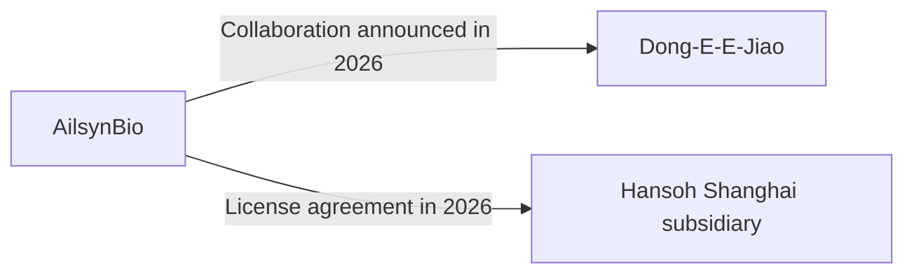

# AilsynBio

[← Home](../../README.md) · [By scope](../../index/by-scope.md) · [Browse by type](../../index/by-type.md) · [By status](../../index/by-status.md) · [By modality](../../index/by-modality.md)

Hong Kong AI-native biotechnology company focused on peptide therapeutics.

**Type:** AI-native biotech · **Status:** Active · **Relevance:** Core · **Loop:** Not assessed · **Region:** HK

## Overview

| Field | Value |
| --- | --- |
| Headquarters | Hong Kong, HK |
| Parent | — |
| Website | — |
| Aliases | AilsynBio Limited, 昂心生物, 昂心生物有限公司 |
| Last verified | 2026-11-17 |

## Peptide relevance and tags

**Directory scope:** AI–peptide work [hkex-20261113-hansoh-ailsynbio](https://www1.hkexnews.hk/listedco/listconews/sehk/2026/1113/2026111300947.pdf)

**Relevance:** Core. [hkex-20261113-hansoh-ailsynbio](https://www1.hkexnews.hk/listedco/listconews/sehk/2026/1113/2026111300947.pdf)

- **Modality:** Macrocyclic peptide

## Dry–wet loop

Not assessed.

## Assets and roles

No assets recorded.

## Timeline

- **2026-11-13** · Confirmed: Hansoh Shanghai subsidiary licensed AilsynBio platform use; aggregate payments may reach RMB 317 million. — Maximum cumulative payment, not received revenue; potential future royalties also apply. [hkex-20261113-hansoh-ailsynbio](https://www1.hkexnews.hk/listedco/listconews/sehk/2026/1113/2026111300947.pdf)
- **2026-04-13** · Confirmed: AilsynBio and Dong-E-E-Jiao announced research cooperation. — Disclosure date. Dong-E-E-Jiao is a subsidiary of China Resources Pharmaceutical Group. [hku-20260413-ailsynbio-donge](https://lead.hku.hk/tc/article/2026/04/hku-incubated-ailsynbio-signs-collaboration-agreement-with-dong-e-e-jiaointegrating-ai-with-traditional-chinese-medicine-to-enhance-biopharmaceutical-innovation/)
- **2026-04-10** · Confirmed: The company registered a Chinese name. [hkcr-20260413-ailsynbio-name](https://www.cr.gov.hk/docs/wrpt/RNC063_2026.04.06-2026.04.12.pdf)
- **2026-03-24** · Confirmed: Gobi-HKU Fund I named AilsynBio among its investees. — Announcement date; investment date, amount, and round were not disclosed. [hkic-20260324-gobi-hku-fund](https://www.hkic.org.hk/zh-Hans/latest-updates/gobi_hku_fundi_pr)
- **2025-12-04** · Confirmed: AilsynBio Limited was incorporated in Hong Kong. [hkcr-20251208-ailsynbio-registration](https://www.cr.gov.hk/docs/wrpt/RNC063_2025.12.01-2025.12.07.pdf)

## Related papers

No papers linked.

## Sources

- **A** [Newly incorporated and renamed companies: 1–7 December 2025](https://www.cr.gov.hk/docs/wrpt/RNC063_2025.12.01-2025.12.07.pdf) · Hong Kong Companies Registry · accessed 2026-11-17
- **A** [Newly incorporated and renamed companies: 6–12 April 2026](https://www.cr.gov.hk/docs/wrpt/RNC063_2026.04.06-2026.04.12.pdf) · Hong Kong Companies Registry · accessed 2026-11-17
- **A** [Collaboration development agreement with AilsynBio](https://www1.hkexnews.hk/listedco/listconews/sehk/2026/1113/2026111300947.pdf) · Hansoh Pharmaceutical Group via HKEX · accessed 2026-11-17
- **A** [香港投资管理有限公司支持戈壁创投与香港大学启动Gobi-HKU Fund I基金](https://www.hkic.org.hk/zh-Hans/latest-updates/gobi_hku_fundi_pr) · Hong Kong Investment Corporation · accessed 2026-11-17
- **A** [港大初創企業昂心生物與東阿阿膠公司簽署合作協議](https://lead.hku.hk/tc/article/2026/04/hku-incubated-ailsynbio-signs-collaboration-agreement-with-dong-e-e-jiaointegrating-ai-with-traditional-chinese-medicine-to-enhance-biopharmaceutical-innovation/) · The University of Hong Kong · accessed 2026-11-17

## Curator notes

*Editorial opinion.*

The following diagram summarizes public announcements; it does not imply a parent or ownership relationship between the parties.

Sources: [University of Hong Kong](https://lead.hku.hk/tc/article/2026/04/hku-incubated-ailsynbio-signs-collaboration-agreement-with-dong-e-e-jiaointegrating-ai-with-traditional-chinese-medicine-to-enhance-biopharmaceutical-innovation/); [Hansoh announcement](https://www1.hkexnews.hk/listedco/listconews/sehk/2026/1113/2026111300947.pdf). The announced maximum payment is conditional; it is not confirmed revenue.
