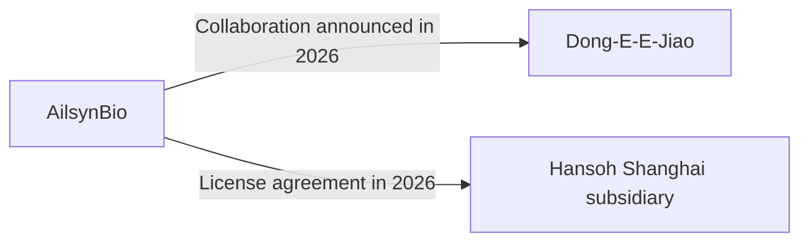

The following diagram summarizes public announcements; it does not imply a parent or ownership relationship between the parties.

Sources: [University of Hong Kong](https://lead.hku.hk/tc/article/2026/04/hku-incubated-ailsynbio-signs-collaboration-agreement-with-dong-e-e-jiaointegrating-ai-with-traditional-chinese-medicine-to-enhance-biopharmaceutical-innovation/); [Hansoh announcement](https://www1.hkexnews.hk/listedco/listconews/sehk/2026/1113/2026111300947.pdf). The announced maximum payment is conditional; it is not confirmed revenue.
