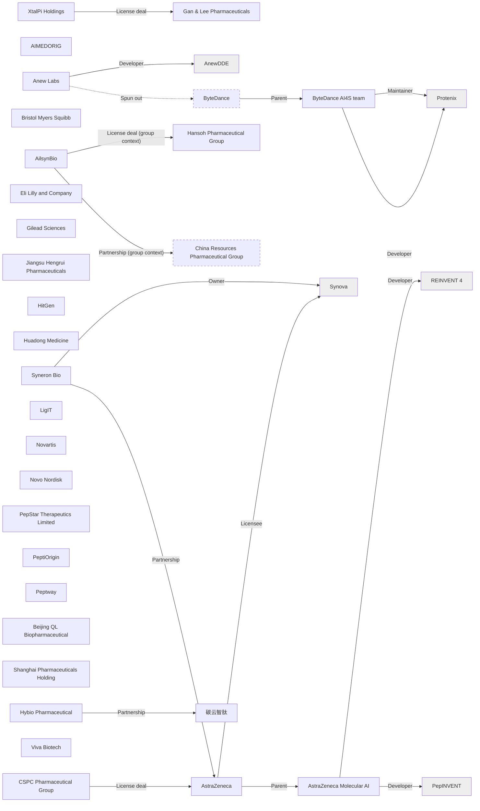

# Lineage

[← Home](../README.md) · [Names](by-name.md) · [Scope](by-scope.md) · [Types](by-type.md) · [Status](by-status.md) · [Modalities](by-modality.md)

Group context edges point to a parent group; see the company timeline for the signing subsidiary.

